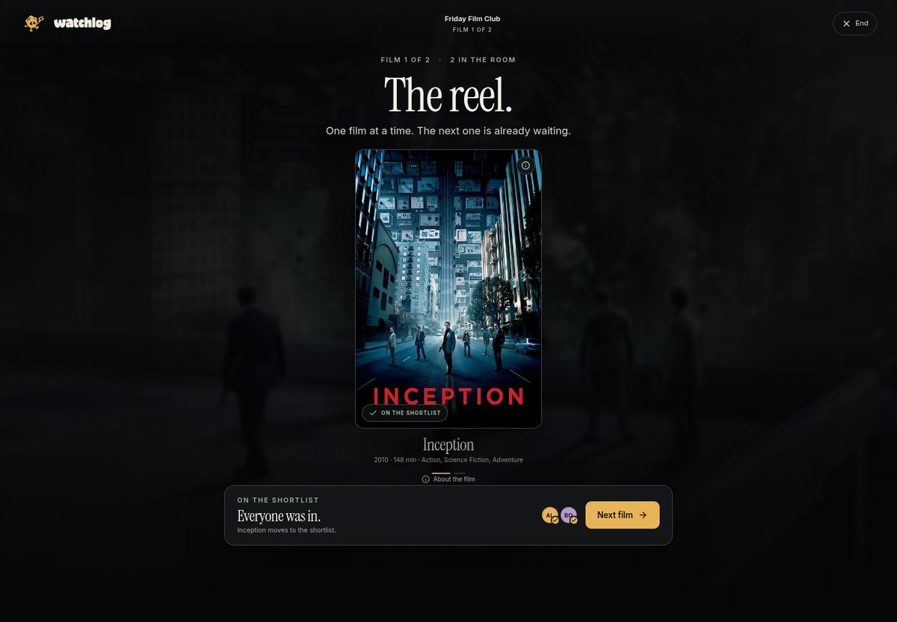

<p align="center">
  
</p>

<p align="center">
  <strong>A quieter place for movie people.</strong><br />
  Group watchlists, club scores, and a real-time movie-night lobby.
</p>

<p align="center">
  
  
  
  
  
  
</p>


## What it is

watchlog turns the group chat, streaming-service hunt and spreadsheet into one
room. A club keeps a shared watchlist and scores; a movie night runs film by
film until every person has one pick and the room has a winner.

**Stack:** FastAPI · PostgreSQL 18 + pgvector · Redis 8 · Celery · React 19 ·
Vite · Docker

- **Groups and watchlists** — invite by link, track films and keep the crew's
  history together.
- **Guest nights** — host or join an open room with just a display name, then
  claim the account later without losing votes or the host seat.
- **Live lobby** — ready up, vote film by film, reveal the ballot together, then
  shortlist unanimous picks and make one final pick each.
- **Scores and availability** — member-only club averages, plus TMDB/JustWatch
  availability cached per region.
- **Accounts** — verification, password reset, email change, session revocation
  and self-serve data export.

## Screens

| The club | The reel |
| --- | --- |
|  |  |

| Groups | Mobile |
| --- | --- |
|  |  |

## Quick start

Docker + Docker Compose, [uv](https://docs.astral.sh/uv/), Node 22+ and npm, and
[just](https://github.com/casey/just).

```bash
cp .env.template .env        # add TMDB_API_KEY for live film search
uv sync
just hooks                   # tests + frontend build before each commit
just dev                     # API, Postgres, Redis, Celery
just seed                    # alice / bob / carol, password: correct horse
just frontend                # Vite on http://localhost:5173
```

SPA <http://localhost:5173> · API <http://localhost:8001> ·
Swagger <http://localhost:8001/api/docs>

Development mail prints to the worker logs. Set `WATCHLOG_MAIL_BACKEND=resend`
and the Resend values for real email.

## Production

```bash
docker compose up -d --build
```

The API listens on `127.0.0.1:8000`; a host reverse proxy terminates TLS and
forwards `/ws`. Migrations run as a one-shot Compose service first. Set secrets
and domain values in `.env` before deploying.

Deploy, rollback, restore, admin and incident steps:
[`docs/production-runbook.md`](docs/production-runbook.md).

## Tests

```bash
just check                         # lint, formatting, Alembic drift, pytest
cd frontend && npm run verify:all  # Playwright flows against the dev stack
```

The Playwright suite needs the dev stack and Vite running. It uses installed
Chrome (`CHROME_PATH`) and mutates the local dev database; screenshots go to
`/tmp/watchlog-verify` (`WATCHLOG_OUT`).

## Documentation

- [Backend architecture](docs/architecture.md) — lifecycle, identity, data model,
  lobby state machine, realtime, email, watch data and design trade-offs.
- [Production runbook](docs/production-runbook.md) — deploy, rollback, restore,
  admin CLI and incident checks.
- [OpenAPI contract](docs/openapi.json) — regenerate with `just openapi` and
  `npm run api:types`.

## License

Copyright (c) 2026 peetsss. All rights reserved.

This repository is publicly available for viewing and evaluation purposes only.

No permission is granted to copy, modify, distribute, or use this software
without prior written permission.
