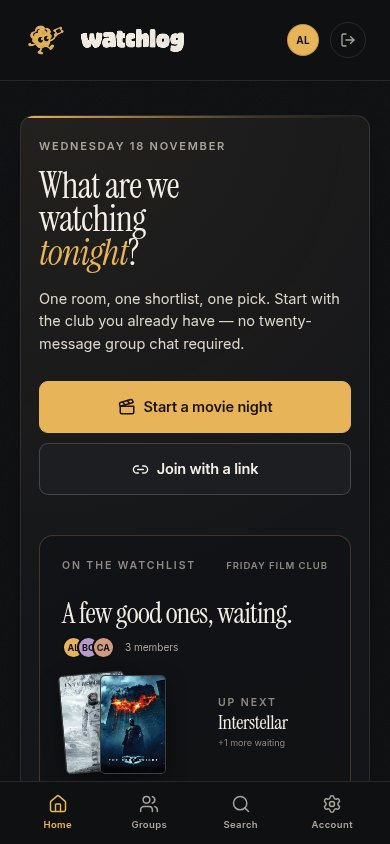

<p align="center">
  
</p>

<p align="center">
  <strong>A quieter place for movie people.</strong><br />
  Group watchlists, club scores, and a real-time movie-night lobby.
</p>

<p align="center">
  
  
  
  
  
  
  
</p>


## Why watchlog?

Picking a film with friends usually means a group chat, three streaming services and a spreadsheet. watchlog turns that into one room: a shared watchlist, honest scores, and a live vote where every person gets one pick.

The app is built around a simple rhythm — **one room, one shortlist, one pick** — with a warm, film-club interface instead of another utility dashboard.

## Features

- **Groups and watchlists** — create a club, invite people by link, add films, mark them watched and keep the crew's history in one place.
- **Guest nights** — open or join an open room with just a display name, then claim the account later without losing your votes or host seat.
- **Club scores** — every member scores out of ten. The club average is derived from the people actually in the group, never from an invented crowd.
- **Film detail on demand** — synopsis, credits, runtime and genres are loaded from the local catalogue when a sheet opens, not stuffed into every list response.
- **Where to watch** — TMDB/JustWatch availability for the finalists and the winner, cached in Postgres for the viewer's region.
- **A real movie-night lobby** — ready up, vote on each film, reveal the ballot together, shortlist unanimous picks, then run a final round of one-pick-each.
- **Live state over WebSocket** — every player sees the same room within a moment. The REST endpoint remains a complete fallback when the socket drops.
- **A home read model** — active room, featured crew, up-next films and a watched log in one request.
- **Secure sessions** — HttpOnly cookie sessions stored in Redis, CSRF double-submit tokens, Origin checks and Argon2 password hashing.
- **Account email** — verification links, password resets, email changes and session revocation after security changes.
- **A typed frontend contract** — OpenAPI types generated from the committed schema, TanStack Query for server state, `openapi-fetch` for requests.
- **One production image** — the SPA is built with Vite and served by FastAPI, alongside the API and WebSocket routes.

## Screens

| The club | The reel |
| --- | --- |
|  |  |

| Groups | Mobile |
| --- | --- |
|  |  |

## How a night works

1. **Open a room** from Home or a group. Everyone marks themselves ready; the host starts with whoever is ready. Unready members leave the room.
2. **Vote film by film.** Each film gets *I'm in*, *Seen it* or *Not for me*. Votes stay hidden until everyone has voted.
3. **Unanimous yes goes through.** The reveal shows the full ballot. A film needs every vote to reach the shortlist.
4. **Pick one finalist each.** Picks stay hidden until the room is done.
5. **The room has spoken.** The winner lands in the group watchlist, and the night is logged on Home.

The backend owns the pool, the order, the reveal and the winner. The UI never invents another player's vote.

## Stack

| Layer | Choice |
| --- | --- |
| API | FastAPI, Pydantic, SQLAlchemy async, Alembic |
| Realtime | WebSocket + Redis pub/sub |
| Data | PostgreSQL 18 with pgvector, Redis 7 |
| Frontend | React 19, TypeScript, Vite, TanStack Query, `openapi-fetch` |
| Auth | Server-side Redis sessions, CSRF, Argon2 |
| Delivery | Multi-stage Docker image; FastAPI serves the built SPA |

```text
Browser
  ├─ HTTP /api/*  ──────┐
  └─ WebSocket /ws/* ───┤
                        ▼
                    FastAPI
                    ├─ PostgreSQL  (catalogue, groups, scores, lobbies)
                    └─ Redis       (sessions, CSRF, lobby pub/sub)
```

## Quick start

### Prerequisites

- Docker + Docker Compose
- [uv](https://docs.astral.sh/uv/)
- Node.js 20+ and npm
- [just](https://github.com/casey/just)

### Development

```bash
cp .env.template .env
# add a TMDB_API_KEY if you want live film search

uv sync
just hooks        # install the pre-commit hook (tests + frontend build)
just dev          # API + Postgres + Redis + Celery worker/beat
just seed         # alice / bob / carol, password: correct horse

just frontend     # Vite on http://localhost:5173
```

- SPA: http://localhost:5173
- API: http://localhost:8001
- Swagger: http://localhost:8001/api/docs
- Health: http://localhost:8001/health

Vite proxies `/api`, `/health` and `/ws` to the API, so cookies and WebSockets work from one origin.

In development the default mail backend prints verification and reset emails to
the Celery worker logs. Set `WATCHLOG_MAIL_BACKEND=resend` and the Resend values
to send real mail.

### Production

```bash
# set WATCHLOG_SECRET_KEY, WATCHLOG_PUBLIC_URL, POSTGRES_PASSWORD and your
# host/origin values in .env
docker compose up -d --build
```

The API publishes only on `127.0.0.1:8000`. TLS is terminated by a reverse
proxy on the VPS, configured on the server outside this repo; it must forward
WebSockets on `/ws` and set the forwarded headers. Keep port 8000 closed at the
firewall. The [runbook](docs/production-runbook.md#host-reverse-proxy) lists the
proxy requirements.

Migrations run once in a dedicated service before the API, worker and beat
start. The API exposes `/health` for liveness and `/ready` for database/Redis
readiness; use `/ready` for external checks.

For real account email, verify a sending domain in Resend and set
`WATCHLOG_MAIL_BACKEND=resend`, `WATCHLOG_MAIL_FROM` and
`WATCHLOG_RESEND_API_KEY`. Transactional mail is sent by the Celery worker from
the `email_outbox` table.

Run `just backup` to write a compressed database dump to `./backups/`. Set
`WATCHLOG_BACKUP_REMOTE` to an rclone remote to upload it, and
`WATCHLOG_BACKUP_RETENTION_DAYS` to change the local retention window.

Deployment, rollback, restore and admin steps live in
[`docs/production-runbook.md`](docs/production-runbook.md).

## Tests

```bash
just check                         # ruff, formatting, Alembic drift, pytest
cd frontend && npm run verify:all  # API-backed Playwright flows
```

`just hooks` installs a pre-commit hook that runs `just check` and the frontend
build. Skip it for a work-in-progress commit with
`SKIP_PRECOMMIT=1 git commit ...` or `git commit --no-verify`.

The browser suite covers a two-user group night, auth and route gates, guest open-room hosting/joining/claim, open-lobby invites, private rooms, the film sheet and mobile layouts. It shortens a test lobby's pool through the dev Postgres container so the full night runs in seconds; see [`frontend/README.md`](frontend/README.md) for prerequisites and cleanup details.

## Project layout

```text
app/                    FastAPI app, services, models, schemas, realtime
alembic/                database migrations
frontend/               React SPA, generated API types, Playwright flows
docs/openapi.json       frozen API snapshot used to generate frontend types
docs/screenshots/       README screens
scripts/                seed, TMDB ingest, embeddings, OpenAPI export
tests/                  API and unit tests
logo/                   brand assets
```

## API

- REST is under `/api`; the contract lives in [`docs/openapi.json`](docs/openapi.json) and is regenerated with `just openapi`.
- Lobby state is personalised: before a reveal you see your vote and the submitted count; after a reveal you see the tally and the ballot. Pick counts only appear after all final picks are in.
- Realtime: `/ws/lobby/<uuid>/` with the session cookie. The server sends the full `lobby.state` on connect and after every change. Close codes: `4401` unauthorized, `4403` forbidden/removed, `4404` not found, `4000` left, `4001` restarted.
- The client reconnects with backoff, deduplicates by `version`, and falls back to `GET /api/lobby/<uuid>/` if the socket is unavailable.

## Data scripts

```bash
just copy-movies --truncate
just ingest --dry-run
just embed --verify
just watch-providers --scope watchlists --limit 500
just seed
```

Watch availability is a Postgres snapshot. The worker refreshes watchlist
providers daily and active finalist rooms when they reach the final round; the
detail sheet refreshes on demand.

TMDB search and film import need `TMDB_API_KEY`. Without it, Search shows a clear offline state instead of a broken catalogue.

## Notes and roadmap

- Guest open-room hosting, joining and account claim are live. Turning a guest room into a saved group (“keep the crew”) is still deferred.
- The lobby pool is 100 random catalogue films by default; there is no scheduling, notifications or admin UI yet.
- Film metadata and imagery come from TMDB. This product uses the TMDB API but is not endorsed or certified by TMDB.
- Watch availability data comes from JustWatch via TMDB. Availability varies by country and can change.
