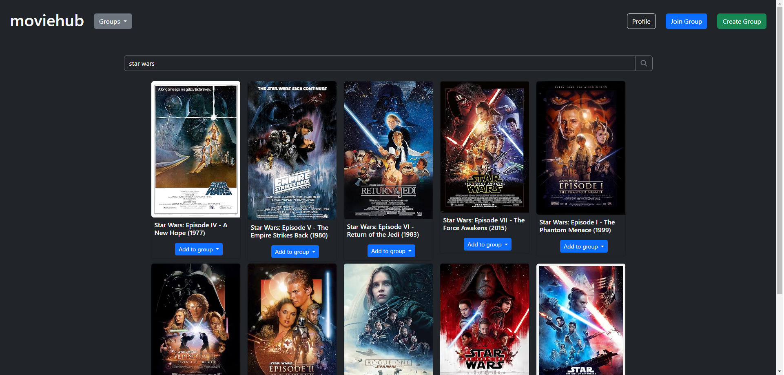
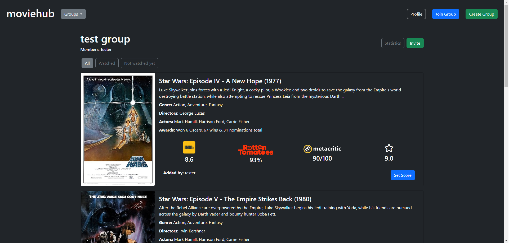

# watchlog

**watchlog** is a web application that allows users to create groups, add movies to a watchlist, and rate them. The application utilizes the TMDB API to gather detailed information about the movies.

## Technologies Used
- Django Framework
- Django Channels with Redis for realtime lobby state
- Bootstrap 5
- PostgreSQL with pgvector
- Docker and Docker Compose
- WhiteNoise for production static files

## Example images
### Index


### Group


## Getting Started

### Prerequisites
Before you begin, ensure you have Docker, Docker Compose and [just](https://github.com/casey/just) installed. [uv](https://docs.astral.sh/uv/) is only needed for running Django or the data scripts directly on the host.

### Setting Up the Environment

Copy `.env.template` to `.env` and fill in the values:

```plaintext
DJANGO_ENV=dev
DJANGO_SECRET_KEY=
DJANGO_ALLOWED_HOSTS=localhost,127.0.0.1

TMDB_API_KEY=your_tmdb_api_key

POSTGRES_DB=watchlog_db
POSTGRES_USER=watchlog
POSTGRES_PASSWORD=watchlog_password
POSTGRES_HOST=localhost
POSTGRES_PORT=5432

REDIS_URL=redis://127.0.0.1:6379/0
```

The production stack sets `DJANGO_ENV=prod` itself. `DJANGO_SECRET_KEY`, `DJANGO_ALLOWED_HOSTS` and `REDIS_URL` must be set before running it, otherwise the app refuses to start.

### Running the Application
Start the development stack (runserver with hot reload):

```
just dev
```

Apply migrations, run the tests, or open a shell:

```
just migrate
just test
just test -- movies
just bash
```

Run every check (ruff lint, formatting, migration drift and tests):

```
just check
```

Django test discovery has to run from `src/`, which is the container's `/app`.
Running `manage.py test` from the repository root finds no tests, since `src`
is not a package. To run the suite on the host instead:

```
cd src && POSTGRES_HOST=127.0.0.1 REDIS_URL= uv run python manage.py test
```

Tests use the in-memory channel layer. The `just test` command does the same,
so it does not need Redis to be running.

### Lobby API and realtime
The lobby JSON API lives under `/api/lobby/`; the WebSocket endpoint is
`/ws/lobby/<uuid>/`. Endpoints, payloads and close codes are documented in
[docs/lobby-api.md](docs/lobby-api.md).

### Production
Build and start the daphne ASGI stack:

```
just prod
```

The container entrypoint waits for PostgreSQL and Redis, applies migrations,
collects static files and starts daphne. Static files are served by WhiteNoise
with hashed, compressed names, so the app does not need a separate web server
for `/static/`. The reverse proxy in front of the container must forward
WebSocket upgrades to port 8000.

### Data scripts
The catalog scripts run against the configured database:

```
python src/movies/scripts/ingest_tmdb.py --dry-run
python src/movies/scripts/ingest_tmdb.py --limit 1000
python src/movies/scripts/embed_movies.py --dry-run
python src/movies/scripts/embed_movies.py --verify
```
