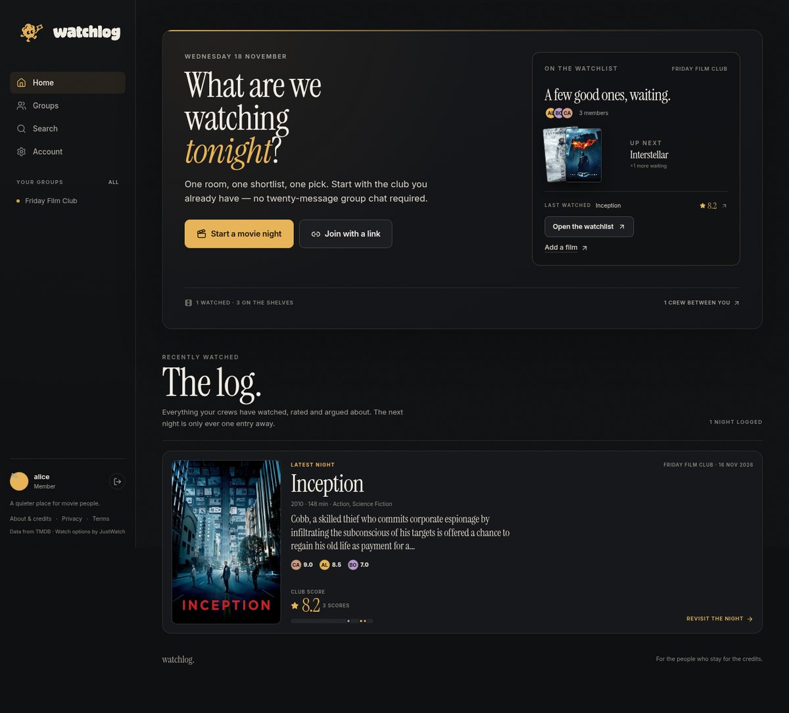
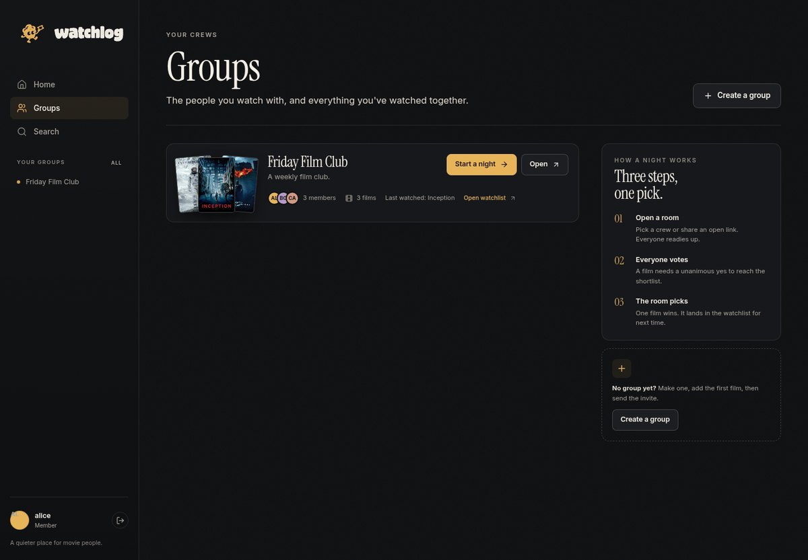

<p align="center">
  
</p>

<p align="center">
  <strong>A quieter place for movie people.</strong><br />
  Group watchlists, club scores, and a real-time movie-night lobby.
</p>

<p align="center">
  
  
  
  
  
  
  
</p>



## What it is

watchlog replaces the group chat, the streaming-service hunt and the
spreadsheet. A club keeps one watchlist, scores films honestly, and settles a
movie night in a live room where every person gets one pick.

- **Groups and watchlists** — invite by link, add films, mark them watched, keep
  the crew's history in one place.
- **Guest nights** — open or join an open room with only a display name, then
  create an account later without losing your votes or host seat.
- **A real movie-night lobby** — ready up, vote film by film, reveal the ballot
  together, shortlist unanimous picks, then run a final round of one pick each.
- **Live state over WebSocket** — REST remains a complete fallback if the socket
  drops; the server owns the pool, the order, the reveal and the winner.
- **Club scores** — every member scores out of ten; the average comes from the
  people actually in the group.
- **Where to watch** — TMDB/JustWatch availability for finalists and the winner,
  cached per region.
- **Accounts and email** — verification, password reset, email change, session
  revocation and self-serve data export.
- **One production image** — Vite builds the SPA; FastAPI serves it alongside the
  API and WebSocket routes.

## Screens

| The club | The reel |
| --- | --- |
|  |  |

| Groups | Mobile |
| --- | --- |
|  |  |

## How a night works

1. **Open a room** from Home or a group. Everyone marks ready; the host starts
   with whoever is ready. Unready members leave the room.
2. **Vote film by film.** Each film gets *I'm in*, *Seen it* or *Not for me*.
   Votes stay hidden until everyone has voted.
3. **Unanimous yes goes through.** The reveal shows the full ballot; a film
   needs every vote to reach the shortlist.
4. **Pick one finalist each.** Picks stay hidden until the room is done.
5. **The room has spoken.** The winner lands in the group watchlist and the night
   is logged on Home.

## Stack

| Layer | Choice |
| --- | --- |
| API | FastAPI, Pydantic, SQLAlchemy async, Alembic |
| Realtime | WebSocket + Redis pub/sub |
| Data | PostgreSQL 18 with pgvector, Redis 8 |
| Frontend | React 19, TypeScript, Vite, TanStack Query, `openapi-fetch` |
| Auth | Server-side Redis sessions, CSRF, Argon2 |
| Runtime | Python 3.14, Celery worker/beat, multi-stage Docker image |

```text
Browser
  ├─ HTTP /api/*  ──────┐
  └─ WebSocket /ws/* ───┤
                        ▼
                    FastAPI  ── PostgreSQL  (catalogue, groups, scores, lobbies)
                        │      └ Redis       (sessions, CSRF, pub/sub, broker)
                        └──── Celery worker/beat ── Resend, TMDB/JustWatch
```

## Development

Prerequisites: Docker + Docker Compose, [uv](https://docs.astral.sh/uv/), Node
22+ and npm, and [just](https://github.com/casey/just).

```bash
cp .env.template .env
# add TMDB_API_KEY for live film search

uv sync
just hooks        # install the pre-commit hook (checks + frontend build)
just dev          # API, Postgres, Redis, Celery worker/beat
just seed         # alice / bob / carol, password: correct horse

just frontend     # Vite on http://localhost:5173
```

- SPA: <http://localhost:5173>
- API: <http://localhost:8001>
- Swagger: <http://localhost:8001/api/docs>
- Health: <http://localhost:8001/health>

Vite proxies `/api`, `/health` and `/ws` to the API, so cookies and WebSockets
work from one origin. The console mail backend prints verification and reset
emails to the worker logs; set `WATCHLOG_MAIL_BACKEND=resend` and the Resend
values for real mail.

## Production

```bash
docker compose up -d --build
```

Set the production values in `.env` first. The API publishes only on
`127.0.0.1:8000`; a reverse proxy on the VPS terminates TLS, forwards `/ws`, and
is configured outside this repo. Keep port 8000 closed at the firewall.

Migrations run as a one-shot Compose service before the API, worker and beat
start. Use `/health` for liveness and `/ready` for database/Redis readiness.
`just backup` writes a compressed database dump; set `WATCHLOG_BACKUP_REMOTE` to
upload it with rclone.

Deployment, rollback, restore, admin commands and incident checks:
[`docs/production-runbook.md`](docs/production-runbook.md).

## Tests

```bash
just check                         # ruff, formatting, Alembic drift, pytest
cd frontend && npm run verify:all  # API-backed Playwright flows
```

`just hooks` installs the pre-commit hook, which runs `just check` and the
frontend build. Skip a work-in-progress commit with
`SKIP_PRECOMMIT=1 git commit ...` or `git commit --no-verify`.

The Playwright suite uses the installed Chrome (`CHROME_PATH` overrides
`/usr/bin/google-chrome`) and writes screenshots to `/tmp/watchlog-verify`
(`WATCHLOG_OUT` overrides). It mutates the local dev database and refuses a
non-local `WATCHLOG_URL` unless `WATCHLOG_ALLOW_REMOTE_VERIFY=1`. Start the dev
stack and Vite before running it.

## Documentation

- [Backend architecture](docs/architecture.md) — request lifecycle, identity,
  data model, lobby state machine, realtime, email, watch providers and jobs.
- [Production runbook](docs/production-runbook.md) — deploy, rollback, restore,
  admin CLI, email, TMDB/JustWatch and incident checks.
- [OpenAPI contract](docs/openapi.json) — frozen schema; regenerate with
  `just openapi` and `cd frontend && npm run api:types`.

## Project layout

```text
app/                    FastAPI app, services, domain, models, realtime, tasks
alembic/                database migrations
frontend/               React SPA, generated API types, Playwright flows
docs/                   architecture, runbook, OpenAPI snapshot, screenshots
scripts/                API entrypoint, seed, TMDB ingest, embeddings, admin
tests/                  API and unit tests
logo/                   brand assets
```

## Data scripts

```bash
just copy-movies --truncate
just ingest --dry-run
just embed --verify
just watch-providers --scope watchlists --limit 500
just seed
```

Watch availability is a Postgres snapshot: the worker refreshes watchlist
providers daily, prefetches active finalists, and the detail sheet refreshes on
demand. TMDB search and import need `TMDB_API_KEY`; without it Search shows its
offline state.

## Scope and attribution

Guest hosting, joining and account claim are live. Turning a guest room into a
saved group (“keep the crew”), notifications, scheduling, RAG and an admin UI
are not part of this release.

Film metadata and imagery come from TMDB. This product uses the TMDB API but is
not endorsed or certified by TMDB. Watch availability comes from JustWatch via
TMDB; availability varies by country and can change.
